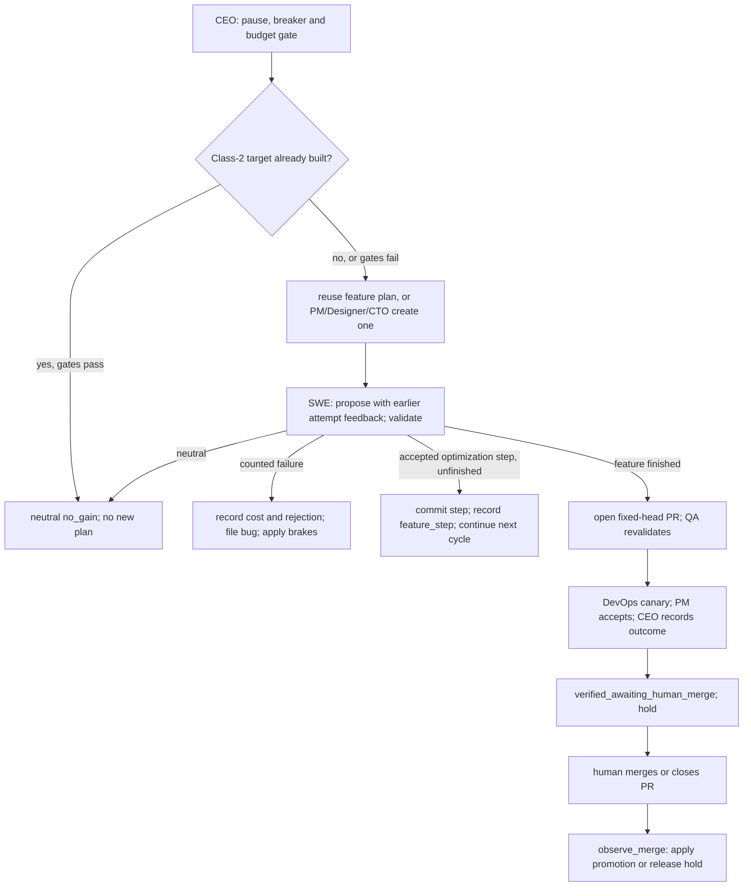

# Code Tour — a reading guide for omnibase

A walkthrough of the codebase aimed at someone comfortable programming but new
to **modern Python** and **Ray**. It explains *why* the code looks the way it
does, points out the language and framework features as they appear, and traces
one full cycle end to end. Read it top to bottom once; after that it's a map.

> New to the project? Read [`README.md`](../README.md) first for what the system
> *does*; this doc is about how the *code* is built.
>
> **Prefer pictures?** [`DIAGRAMS.md`](DIAGRAMS.md) has the same material as UML:
> a [class diagram of the ports, adapters and the contract](DIAGRAMS.md#1-class--ports-adapters-and-the-contract)
> for §6 below, and an
> [activity diagram of the gauntlet](DIAGRAMS.md#3-activity--the-validation-gauntlet)
> for §5.

---

## 1. The 10,000-foot view

omnibase is a control loop that improves a piece of code, gated hard so it can't
break things. An **actor org** (CEO/PM/CTO/SWE/QA/DevOps/Designer) drives the
loop by reading and writing **artifacts** (Confluence pages, Jira issues, GitHub
PRs), and a **SelfModel** actor keeps a live picture of the running system.

The single most important idea: **the LLM is never trusted — the deterministic
gauntlet is.** Everything else exists to feed that gate and to act safely on its
verdict.

Two layers, deliberately kept apart:

```
omnibase/                # repo root
├── sis/                 # THE ENGINE — STRICT/FORBIDDEN under the change policy
└── runtime/             # MUTABLE STATE the engine reads/writes at run time
```

The shipped loop writes designated target modules under `runtime/`. Guardrails
are FORBIDDEN; other engine code is STRICT, requiring an explicit policy opt-in
and human approval. The directory split helps keep targets separate, but
`sis/policy.py` defines what can actually change.

---

## 2. Ray in five minutes (the concepts this code uses)

[Ray](https://docs.ray.io) turns a plain Python class into a distributed
**actor**: an object that lives in its own process, holds state, and is reached
by sending it messages. omnibase uses a small, specific slice of Ray — here's
all of it, mapped to where you'll see it.

| Concept | What it means | Where in the code |
|---|---|---|
| `@ray.remote` on a class | Makes it an **actor** — each instance runs in its own worker process | `sis/roles.py`, `sis/self_model.py`, `sis/workspace.py` |
| `Actor.remote(...)` | Construct an actor instance (returns a **handle**, not the object) | `org.bootstrap()` |
| `handle.method.remote(args)` | Call a method **asynchronously** — returns an `ObjectRef` (a future), doesn't block | everywhere a role does work |
| `ray.get(ref)` | **Block** and fetch the actual return value from an `ObjectRef` | everywhere we need the result |
| named + `lifetime="detached"` | Register an actor under a cluster-wide **name** so any process can look it up, and keep it alive independent of who created it | `Workspace`, `SelfModel`, all seven roles in `org.bootstrap()` |
| `ray.get_actor(name)` | Look up an existing named actor by name | `get_workspace()`, `get_self_model()` |
| `ray.init(...)` | Start (or connect to) a local Ray cluster | `org.bootstrap()`, `main.py` |

**The mental model:** an actor handle is like a phone number. `.remote()` places
a call and immediately hands you a "I'll call you back" ticket (`ObjectRef`).
`ray.get()` waits on hold until the answer comes. You'll see the pattern

```python
result = ray.get(some_actor.some_method.remote(arg))
```

constantly — that's "call this actor's method and wait for the answer."

**Why named + detached for the roles and shared state?** Because the role
actors run in *separate processes* and must all see the *same* artifacts. If
each held its own copy of the data, there'd be no shared bus. Instead, one
`Workspace` actor owns the data and everyone looks it up by name — see
`sis/workspace.py`. This is the key Ray design decision in the project.

`org.bootstrap()` creates the roles centrally with `get_if_exists=True`. The
CEO/PM/CTO spawning hierarchy in the role design is not implemented as Ray
child ownership. SelfModel stores registrations, contracts, deploy state and
provenance; its substrate view is cluster resource totals, Python and platform,
not per-node mailbox, disk, network or AWS inventory monitoring.

> **Gotcha you'll hit when learning Ray here:** state lives *inside* an actor.
> Mutating a Python object you passed *into* an actor doesn't change the actor's
> copy — you have to call a method on the actor. That's why all artifact changes
> go through `Workspace` methods, never by poking a returned dataclass.

---

## 3. Modern Python features you'll see (and why)

This codebase is a tour of current Python on purpose — you said you're learning.

- **`from __future__ import annotations`** (top of most modules) — makes all type
  hints lazy strings, so you can annotate with types that aren't imported at
  runtime and avoid circular-import pain. Standard in new code.
- **Type hints everywhere + `mypy --strict`** — every function is annotated and
  checked. This isn't decoration: type-correctness is a *gauntlet gate*, so
  generated code must pass it too. Run `poetry run mypy --strict sis/`.
- **`typing.Protocol`** (`sis/ports.py`) — *structural* interfaces. A class
  satisfies a `Protocol` just by having the right methods; it doesn't subclass
  anything. This is how the in-memory adapters and the real Confluence/Jira/
  GitHub adapters are interchangeable — see §6.
- **`@dataclass`** (`sis/ports.py`, `sis/self_model.py`) — auto-generates
  `__init__`/`__repr__`/`__eq__` from typed fields. `field(repr=False)` +
  a custom `__repr__` in `sis/settings.py` is how secrets stay out of logs.
- **`enum.Enum`** (`IssueType`, `IssueStatus`) — closed sets of values instead of
  magic strings.
- **Context managers** (`with tempfile.TemporaryDirectory()`) — guaranteed
  cleanup; the gauntlet builds a throwaway sandbox dir and it's removed on exit.
- **`importlib.util`** — load a module by path. Candidate modules are loaded
  inside their sandbox workers; the host loads trusted spec/oracle code.
- **`subprocess`** (`sis/gauntlet.py`, `sis/sandbox_worker.py`) — separate trusted
  harnesses from candidate workers, with timeouts and process/container cleanup.
- **Lazy imports** (`import anthropic` *inside* a function) — optional
  dependencies (`anthropic`, `boto3`, `requests`, `yaml`) are imported only when
  actually used, so the default path needs none of them installed.

---

## 4. Where to start reading

Read in this order — each builds on the last:

1. **`runtime/target.py`** — a thing being optimised. A deliberately slow
   `sum_of_divisors`. Tiny; start here. Then `runtime/sort_target.py` (a naive
   bubble sort), then `specs/roman/` (feature construction) and `sis/contract.py`.
   The registry declares the shipped targets; the validation machinery takes a
   contract rather than branching on a target name.
2. **`sis/gauntlet.py`** — `validate(code, baseline, contract=...) -> Result`. The moat. Read
   this closely; it's the heart of the safety story (§5). Its sibling
   `sis/sandbox_worker.py` serves a candidate *hot* from the same sandbox, over
   stdin/stdout, for gates and future canary isolation (`docs/STAGED_DELIVERY.md`).
3. **`sis/proposer.py`** — `propose(...) -> code`. Stub by default; real Claude
   behind a flag. Small.
4. **`sis/ports.py` + `sis/adapters.py`** — the ports/adapters pattern (§6).
5. **`sis/workspace.py` + `sis/self_model.py`** — your first Ray actors: the
   shared, named substrate every role reads and writes through.
6. **`sis/roles.py`** — the seven role actors. Each is small and focused.
7. **`sis/org.py`** — wires it together and runs one cycle. The conductor.
8. **`sis/episodic.py`** — the provenance/episodic store (§7b): what every cycle
   tried and why it was accepted or rejected.
9. **`main.py`** — the entry point.

Also worth a look: **`sis/policy.py`** (§7a, what the loop may change),
**`sis/config.py`** (§7c, every knob the engine has, declared once),
**`sis/cost.py`** (LLM pricing feeding the CEO's spend brakes), and
**`sis/llm.py`** — the proposer's model choice sits behind a small `Protocol`
(`LLMClient`), so a real proposer isn't locked to one vendor; every
adapter returns cost alongside text so the spend brakes are vendor-agnostic
too. When you're ready for the serving/canary layer (loaded once a candidate
has already passed the gauntlet), see §8.

The tests under `tests/` are also excellent documentation — each shows a piece
in isolation. `tests/test_adversarial.py` in particular shows *what the gauntlet
refuses*, which is the clearest statement of the safety contract.

---

## 5. The gauntlet, gate by gate (`sis/gauntlet.py`)

`validate()` follows `Contract.gate_profile()` and stops at the first failure.
The same dispatcher handles optimization and feature construction:

| Order | Gate | Optimization | Feature construction |
|---|---|---|---|
| 1 | `ast.parse` | yes | yes |
| 2 | byte-identical no-op | yes | skipped |
| 3 | `mypy --strict` | yes | yes |
| 4 | public API/interface | yes | yes |
| 5 | trusted acceptance tests | yes | yes |
| 6 | invariants over generated inputs | when declared | when declared |
| 7 | recorded backtests | when declared | when declared |
| 8 | differential correctness + benchmark | yes | skipped |
| 8 | SLO latency budget | skipped | when declared |

`sum_of_divisors` and `sort` are optimization contracts; `roman` is a feature
contract. A feature has no reference implementation to beat. Its public API,
acceptance cases and domain laws define correctness; optional backtests add
recorded evidence and an optional SLO adds a latency budget. No shipped contract
declares an SLO yet. See [CLASS2_CONTRACT.md](CLASS2_CONTRACT.md) for details.

### Which process owns what

Candidate code never runs in the actor process that holds credentials.
`SandboxWorker` runs it in the configured subprocess or Docker sandbox.
Acceptance, invariant and backtest scripts run as **trusted host harnesses**
through `_run_harness()`. Their `target` module is a proxy: each call crosses
stdin/stdout as JSON to a candidate worker. The interface gate asks a worker
what it exports. The benchmark's reference, clock and verdict also stay on the
host; candidate and baseline have separate workers.

The SLO gate is the remaining exception to process separation: it measures and
judges its candidate in the same sandboxed process. Its fixed-workload limitation
is recorded in [KNOWN_ISSUES.md](KNOWN_ISSUES.md), OMNI-86. Do not use its design
as a pattern for new gates.

The exam directory holds trusted tests, laws, fixtures and candidate source;
Docker mounts it read-only. Scratch space is separate and off `sys.path`.
`_GateContext.put()` records trusted-file hashes, and every gate checks for
changed, added, missing or linked files before accepting a verdict. A process
exit alone is insufficient: harnesses must produce the expected verdict.

The worker protocol carries plain JSON values. Returned tuples arrive as lists;
non-wireable arguments are an exam fault (`NotWireable`). The proxy mirrors
argument mutation and represents candidate exceptions as builtin exceptions;
`SystemExit` is a failure. Contracts must account for this wire boundary.

### Benchmarking without rewarding the wrong thing

Optimization correctness uses a trusted reference on randomized inputs.
Performance uses total candidate cost divided by total baseline cost, with a
paired-bootstrap interval. Candidate and baseline run back-to-back on the same
unused inputs, alternating order. The verdict is accept, reject, or neutral
**inconclusive** when the estimated gain clears the margin but its interval does
not. A byte-identical no-op is also neutral; both record spend.

`_UnusedInputs` keeps timed inputs distinct from all prior worker inputs,
including differential and batch-sizing calls. Batches shrink when the oracle
cannot supply enough unused inputs; an insufficient range is a harness fault.
Timed batches use `_plain_batch()`'s C-level `itertools.starmap` path, with no
per-call Python harness work. Docker confines the two benchmark workers to
separate single CPUs and swaps them halfway through. The subprocess sandbox
cannot enforce CPU confinement. See OMNI-152/153/154 in
[KNOWN_ISSUES.md](KNOWN_ISSUES.md) for the adversarial examples behind these rules.

### Sandbox and canary limits

`SIS_SANDBOX` selects a soft subprocess boundary or Docker isolation. Subprocess
scrubs credentials and injects a network guard but leaves host files readable.
Docker uses no network, a read-only exam mount, separate scratch space, resource
limits and the host user's non-root uid. A non-stub proposer requires Docker
unless the explicit unsafe override `SIS_ALLOW_UNSANDBOXED_LLM=1` is set.
Per-gate timeouts kill hangs. A failed gate triggers a trusted sandbox probe;
if that probe fails too, the verdict is `harness:`, not a candidate defect.

A Ray Serve replica is not safe for untrusted code: Serve workers can reach
the Ray control plane even with scrubbed environments. So a replica never runs
the candidate it serves; `TargetDeployment` (`sis/serving.py`) forwards each
request to a `SandboxWorker` (OMNI-48). `--canary serve` is still refused with
any non-stub proposer, with no override, until a human lifts that refusal (M19). It is also refused
for Class-2 contracts. The recording canary executes no candidate code.

> Reading route: `_run_harness()` and `_install_proxy()` show trusted execution;
> `SandboxWorker` shows the JSON boundary; `_docker_args()` shows container
> isolation; `_judge()` and `_timed_work()` show the benchmark.

---

## 6. Ports & adapters — swapping fake for real (`sis/ports.py`, `adapters.py`, `adapters_real.py`)

This is the pattern that lets the whole org run locally with zero credentials
*and* talk to real Confluence/Jira/GitHub later, with the roles unchanged.

- **`ports.py`** defines five `Protocol`s — `DocumentStore`, `WorkTracker`,
  `VersionControl`, `Cloud`, `Telemetry` — the *capabilities* the org needs.
- **`adapters.py`** implements them in memory (the default — an artifact bus
  that needs nothing external).
- **`adapters_real.py`** implements the same Protocols against real REST APIs
  (validated live at runbook Level 2). Two live-tenant behaviours worth knowing:
  `create_page` is idempotent across runs (Confluence rejects duplicate titles
  per space, so it updates the existing page in place) and drops a cross-space
  `parentId` rather than fail (Confluence can't represent it; provenance is in
  the SelfModel).
- **`workspace.py`** picks which set to use based on config (`SIS_ADAPTERS`).

Because a `Protocol` is satisfied structurally, the roles just call
`workspace.create_issue(...)` and neither know nor care whether that's an
in-memory dict or a live Jira call. Swapping is a config flag, not a rewrite.
The destructive operations (delete, merge) raise `RequiresHumanApproval` in
*both* implementations — the guardrail lives in the port contract. `promote()`
is gated differently since OMNI-15: it no longer raises, but its only caller
(`DevOps.observe_merge`) acts solely after reading a PR back as merged — a state
the agent cannot produce, precisely because `merge_pr()` always raises.

---

## 7. One cycle, end to end (`sis/org.py :: run_cycle`)

The driver calls actor methods with `ray.get(actor.method.remote(...))` and
records handoffs as artifacts. A cycle can add a feature step; it need not open
one PR per candidate.



An optimization starts from the merged base for a new feature and then its
feature branch's accepted head. Rejected attempts feed the next prompt. A
finished feature opens one PR whose head stops moving. A Class-2 feature is
finished at its first step that passes every gate; an already-built feature is
revalidated before creating any plan. See [STAGED_DELIVERY.md](STAGED_DELIVERY.md).

QA and the canary can reject a finished feature. A passing cycle ends at
`verified_awaiting_human_merge`; `loop.serve()` watches for the human decision.
`DevOps.observe_merge()` then executes promotion, but never merges or makes the
approval decision. A closed or missing PR releases the hold.

Counted failures file bugs and contribute to the breaker. Neutral `no_change`,
`no_gain` and `inconclusive` outcomes record spend without a bug or breaker
increment. Exceptions inside a cycle are charged and recorded as `error`, with
any canary set by that cycle retired. A trip pages through the Notifier as well
as filing a breaker bug. Provenance roots at the CEO's idempotent charter and
links the feature's specs, issues, accepted commits, PR and outcome.


`CEO` holds three brakes (`sis/roles.py`): a hard spend cap, a consecutive-failure
breaker, and a cost-per-accepted-improvement SLO. The brake decision is a *pure
function* (`evaluate_brakes`) so it's unit-testable without Ray — a useful pattern
to copy: keep the decision logic pure, keep the I/O in the actor.

---

## 7a. What the loop may change — the policy (`sis/policy.py`)

The loop rewrites code, so *which* code it may touch is a safety question, not a
detail. `sis/policy.py` answers it with three tiers, checked before any change
is proposed or written:

| Tier | Paths | Loop may modify? | Bar |
|---|---|---|---|
| **FORBIDDEN** | guardrail/safety code | **Never — no override** | — |
| **STRICT** | all other engine code | Off-limits by default | when enabled (`SIS_ALLOW_STRICT_CHANGES=1`): pass checks **+ human-approved + justified** (exception or human request) |
| **SOFT** | the designated target(s) | Yes | pass checks; review via QA + human merge |

The **FORBIDDEN** set (`GUARDRAIL_PATHS`) includes the gauntlet, the contract
layer, secret handling, the adapter guardrails, the sandbox image, **the
configuration** (`sis/config.py` + `config.yml`, §7c) — **and `policy.py`
itself**, so the loop cannot loosen its own rules. There is no approval that
unlocks FORBIDDEN; that's the load-bearing invariant (a rewriter that can edit
its own validator can validate away its constraints).

Two enforcement points:

- `SWE.implement` (`sis/roles.py`) calls `authorize_change(TARGET_PATH, …)` after
  the gauntlet passes and before opening a PR — a mis-pointed target rolls the
  cycle back with `Policy blocked: …`.
- `GitHubVersionControl._put_file` (`sis/adapters_real.py`) refuses to write any
  FORBIDDEN path with `RequiresHumanApproval`, regardless of caller — a hard
  belt-and-suspenders stop.

**Widening scope** is a deliberate, reviewed change: set `policy.target_paths`
(`SIS_TARGET_PATHS`, comma-separated, repo-relative) to add SOFT targets.
Guardrail paths always win over that list (`classify` checks `GUARDRAIL_PATHS`
first), so you can never accidentally make safety code writable by listing it as
a target.

That ordering carries more weight than it looks. The target list is *itself* a
configuration key, so "name the configuration as an optimisation target, then
let the loop rewrite its own spend cap" is the obvious escalation — and it is
inert, because the guardrail check runs first and `config.yml` is in the
FORBIDDEN set. `tests/test_config.py` asserts exactly that: the setting takes
effect, and it buys nothing.

> Pattern to copy: like `evaluate_brakes`, the whole policy is **pure functions
> over data** (`classify`, `authorize_change`) — no Ray, no I/O — so it's
> exhaustively unit-tested in `tests/test_policy.py`.

## 7b. The episodic store — what it learns from (`sis/episodic.py`)

The single most valuable output isn't the optimised code; it's the record of
*what was proposed, why, and what happened* — including **every rejected diff and
the gate that caught it**. That's the dataset a self-improving system learns
from, so it's a first-class, queryable output rather than a log file.

`org.run_cycle` writes one `EpisodicEvent` per outcome (guarded — episodic
logging can never break a cycle). The store is a **port** with swappable backends
chosen by `SIS_EPISODIC_STORE`:

- `jsonl` (default) — append-only, zero-dependency, durable.
- `duckdb` — embedded SQL analytics (`summary()` rollups + an `sql()` escape
  hatch); optional `poetry install --with analytics`.
- `none` — disabled.

The schema (`EpisodicEvent`) is the point — `outcome`, `reject_gate`,
`candidate_sha`, `cost_usd`, before/after latency. A shared pure `summarize()`
makes rollups identical across backends, and the DuckDB column schema is
*asserted* against the dataclass so it can't drift. Postgres + pgvector can drop
in later (multi-node cluster / embedding retrieval) without touching the loop —
the same ports/adapters move as Confluence/Jira/GitHub.

## 7c. Configuration — one schema, four layers (`sis/config.py`)

Every knob the engine has is declared exactly once, in `SCHEMA`:

```python
Key("sandbox", "mode", ConfigTier.FORBIDDEN, Kind.STR, "subprocess",
    "SIS_SANDBOX", "Isolation for generated code: 'subprocess' or 'docker'.",
    choices=("subprocess", "docker")),
```

Everything else is *derived* from that one line: the typed `Config` object the
engine reads, the committed `config.yml`, the `--sandbox-mode` CLI flag, and the
`--show-config` view. Adding a knob is one `Key(...)` plus
`python -m sis.config --write`; a test regenerates the file and compares, so the
committed file cannot drift from the code.

```
CLI flag  >  environment variable  >  config.yml  >  built-in default
```

Three design points worth understanding before you add to it:

- **Values are validated, and a typo in a security control is loud.**
  `SIS_SANDBOX=dcoker` used to compare unequal to `"docker"` at every read site,
  so the engine ran untrusted generated code in the *soft* sandbox and said
  nothing at all. Anywhere a wrong value fails silently *and* unsafely, the key
  declares `choices`.
- **The `forbidden_`/`strict_`/`soft_` prefix is about human authority, not the
  loop.** It gates what an operator may edit in the UI (OMNI-28). The loop is
  stopped by `config.yml` and `sis/config.py` both being FORBIDDEN (§7a),
  whatever any individual key says — and the file may not renegotiate its own
  tiers, so writing `soft_budget_usd` is rejected rather than quietly accepted.
- **The file layer reaches the Ray actors; the environment layer may not.** Role
  actors are detached actors in their own OS processes and snapshot the
  environment when they are *created*, so an `export` after `bootstrap()` is
  invisible to them (the trap in §10's glossary, and the reason `--contract` is
  passed as an argument). Each actor reads `config.yml` from disk itself, so the
  file does reach them — and `apply_cli_overrides` writes CLI values through to
  `os.environ` *before* bootstrap for the same reason. Without that,
  `--sandbox-mode docker` would configure the driver and leave the actor that
  actually runs the gauntlet on the subprocess sandbox.

Secrets are deliberately **not** here: `config.yml` is committed, so anything in
it is public. Credentials live in `secrets.local.yml` behind `sis/settings.py`,
which masks them in `repr()` (§3).

---

## 8. Serving a target and canarying it live (`sis/serving.py`, `sis/loadgen.py`, `sis/canary.py`, `sis/serve_cloud.py`, `sis/metrics.py`)

> [`DIAGRAMS.md`'s deploy-slot state machine](DIAGRAMS.md#4-state--issue-workflow-and-deploy-slots)
> is the blue/green picture for this whole section.

Everything through §7 answers "is the candidate correct and faster, measured
once, offline, in a quiet sandbox?" This layer answers a harder question: is it
*still* faster once real, concurrent traffic is queuing for it? The offline
benchmark times serial batches in isolated workers; it does not measure Serve
queueing or concurrent endpoint dispatch. Measured field example: a merge-sort candidate
was **~5x faster in isolation** (0.88ms → 0.17ms) but only **~30% faster at p95
under 8-way concurrent load** (237.90ms → 167.78ms) — both versions become
queue-bound under real concurrency. That gap is this whole layer's reason to
exist.

**`sis/metrics.py`** is the smallest piece and everything else depends on it: a
pure `percentile()`/`Window`/`summarise()` — nearest-rank percentiles over
observed latencies, no interpolation, because a canary window is a sample of
requests that actually happened. Shared so the offline gauntlet and the online
canary compute "p95" the same way.

**`sis/serving.py`** puts a contract's entry function behind Ray Serve —
`TargetDeployment` wraps the function; `CanaryRouter` sits in front of a blue
(live) and an optional green (candidate) deployment. It exists because **Ray
Serve has no built-in weighted traffic split** — routing a request to one
version or the other, at a configurable weight, is not a framework feature, so
`CanaryRouter` *is* the split. Two dispatch modes (`CanaryMode`): `SHADOW`
(default) sends every sampled request to *both* versions and returns only
blue's answer — the candidate can be arbitrarily wrong and no caller ever sees
it, which is what makes a paired latency comparison and a direct
answer-agreement check possible; `SPLIT` sends each request to exactly one
version (no pairing, but half the compute).

> **A finding worth knowing before you touch this:** the router, blue and green
> were first built as *one* Serve application. Adding a canary meant re-running
> that whole graph — which restarts the **blue** replica, discarding its warm
> state at the exact moment blue becomes the baseline everything is measured
> against. Green is now deployed as its own, separate application that the
> router *attaches to* at runtime, so a canary deploy or rollback never touches
> blue. This wasn't predicted; it was measured (give blue a construction-time
> identity, watch it change) and then fixed — the kind of bug that only shows
> up once something actually runs continuously.

**`sis/loadgen.py`** generates the traffic a canary needs, since nothing
external calls the target yet. Inputs come from the contract's own oracle
(`random_input`) — the same function the offline gauntlet's differential-
correctness gate already trusts — rather than a second, independently-written
generator that could quietly drift from it.

**`sis/canary.py::evaluate_canary()`** is the pure decision function — no Ray,
no Serve, no network, mirroring `evaluate_brakes`/`gauntlet.validate`'s
gate-functions-are-pure convention. Four gates, cheapest first, **everything
fails closed** (a predicate that raises counts as a violation, not an
exception that propagates):

1. Evidence floor — enough samples to say anything at all.
2. Correctness (hard) — zero violations of declared, bound invariants. The
   two shipped optimization contracts declare none, so response agreement is
   their live correctness signal. `roman` has laws but is refused by Serve.
3. Response agreement (hard, `SHADOW` only) — blue and green must have
   answered every sampled request identically.
4. Performance (graded) — candidate p95 *and* p99 within a configurable ratio
   of baseline's.

**`sis/serve_cloud.py::ServeCloud`** is the real `Cloud` port adapter that ties
the above together — a third implementation alongside the in-memory fake and
the real-adapters placeholder, needing only `ray[serve]` (no credentials). Its
`deploy_canary`/`shift_traffic`/`live_metrics` do for real what `InMemoryCloud`
fakes. `promote()` does not raise — it is gated by `DevOps.observe_merge()`
reading a PR back as *already* merged, the same human-approval invariant
enforced one layer up instead of by the adapter refusing outright (see §6).
Green's replica runs with a scrubbed `runtime_env`, but remains a Ray worker
with control-plane access. The non-stub-proposer refusal in §5 is mandatory.
The live latency/error-rate decision also has open defects (OMNI-50); these
mechanics are not certification for production use.

**Where this plugs into the cycle you already read in §7:** `DevOps.canary()`
takes an optional `canary_backend`. Left unset, it's exactly what §7 described
— record the sandbox-measured latency, deploy to the green slot, never execute
anything. Pass `"serve"` (or `SIS_CANARY=serve` / `main.py --canary serve`) and
it runs the real flow instead: deploy behind `ServeCloud`, drive a bounded
`loadgen` burst through the router to fill the window (the real target has no
traffic of its own yet — same bootstrap problem `loadgen` exists to solve),
then `evaluate_canary()` decides. **Forced to `SHADOW` regardless of
configuration** — the shipped optimization contracts have no invariants, so a weighted
split would have zero live correctness signal, only a speed comparison, which
could silently wave a fast-but-wrong candidate through.

The one behavioural change worth calling out explicitly: **a live rejection can
now overrule QA's approval.** Before this layer existed, `run_cycle`'s outcome
was QA's call alone. `org.cycle_outcome` — another pure fold, same convention
as everywhere else in this doc — now also asks whether a live evaluation ran
and passed; a `None` canary (the default backend, or QA already said no)
reduces to exactly the old behaviour.

---

## 8a. The loop as a server (`sis/loop.py`)

`main.py` on its own runs **one** cycle and exits — useful for reading the
trace in §7. `sis/loop.py` is the difference: `serve()`
runs cycles continuously, gated by a pure `decide()` (same pure/impure split as
everywhere else — `poll()` does the I/O, `decide()` is the testable policy).

Two review gates worth understanding:

- **`canary_in_flight()`** — while green is occupied, the loop holds the next
  cycle rather than stacking a second proposal on an unmerged predecessor
  (cycles baseline from the *merged* target, so a second cycle would just
  re-propose the same diff and spend again for it).
- **`pending_merge()`** paired with **`DevOps.observe_merge()`** — polled once
  per tick while a canary is held. This is what actually *releases* the hold:
  it reads the PR back from version control and, only if a human has already
  merged it, promotes and frees green. The loop can never merge anything
  itself — `merge_pr()` raises `RequiresHumanApproval` in every adapter, so
  the only way `merged` ever becomes true is a person clicking merge on
  GitHub.

Before this existed, `main.py --loop` ran one successful cycle and then idled
forever, because nothing ever cleared the green slot on success (only
rollback did). That was arguably the *correct* reading of "stop at the human
gate" — but permanently, not just until a human acts.

---

### Persistence, convergence and operator control

Pending PR state is persisted and real-adapter runs also recover outstanding
loop PRs from GitHub. Accepted feature steps and plans are persisted separately,
so a restart can resume unfinished work. Convergence stops the loop
politely: `loop.converged_after` no-op or no-gain cycles in a row. An
inconclusive result is neutral for the breaker but resets that count
(OMNI-145). `main.py` holds `runtime/loop.lock` for its entire
run; a second start exits 3 naming the holder.

`python -m sis.admin` inspects or pauses/resumes the live CEO and resets the
breaker with a written reason. Reset preserves spend. Unreadable stored brake
state opens the breaker at boot and is not overwritten. Real-adapter or
non-stub-proposer runs require a persistent episodic backend.

## 8b. Sensor input and replay

`Sensor` is passed explicitly to its consumer, separate from the artifact bus.
Each `Reading` has `event_time` and `known_at`; every read names `TimeAxis`.
`SimSensor` replays readings. `EIASensor` captures a bounded set of EIA series
and reads them from an append-only local trace. Neither selecting the backend
nor running the control loop automatically captures observations or builds a
domain model.

`sis/sensor_input.py` is the untrusted-data boundary: every fetched record
becomes a reading, an explicit `Absent`, or a counted rejection. Free text uses
`UntrustedText`, never raw interpolation. `sis/sensor_trace.py` records capture
provenance, readings, absences, revisions and reconstructed timestamps, and
checks them again on read. Capture is staging; a human-approved fixture is the
exam. See [SENSOR_RUNBOOK.md](SENSOR_RUNBOOK.md) for commands and limitations.

---

## 9. How to run and poke at it

```bash
poetry install
poetry run python main.py        # one full org cycle (in-memory, no creds)
poetry run python main.py --show-config          # every setting + where it came from
poetry run pytest                # fast suite; excludes Serve
poetry run pytest -m serve -n 0   # Serve integration; serial
poetry run mypy --strict sis/ main.py scripts/   # the type gate
```

Good first experiments to build intuition:

- Make `runtime/target.py` already fast (paste the O(√n) version in) and run a
  cycle — watch it roll back with "no improvement."
- Add a bug to a candidate in `tests/test_adversarial.py` and watch which gate
  catches it.
- Set `SIS_PROPOSER=claude` (with `--with llm` + a key) and read the prompt in
  `sis/proposer.py` — then watch the same gauntlet judge a real LLM's diff.
- Run a few cycles with `SIS_EPISODIC_STORE=duckdb` (`--with analytics`), then
  query the log: `get_episodic_store("duckdb").sql("SELECT reject_gate,
  count(*) FROM episodes GROUP BY reject_gate")`.
- Run `poetry run python main.py --contract sort --canary serve` (§8) and read
  the printed verdict: real dispatched requests, a real paired p95/p99
  comparison — not a number copied from the offline benchmark. (A candidate
  that answers *wrong* gets caught earlier, by §5's offline differential gate,
  before a canary ever sees it — the live gates in §8 catch what only shows up
  under real concurrency, which is a different failure class entirely.)

---

## 10. Glossary

- **omnibase** — this project / engine (the `sis/` package).
- **omnitrack** — the future end product (the external-world-modeling layer).
- **actor** — a Ray object living in its own process, reached via a handle.
- **artifact** — a durable record (page/issue/PR) the org coordinates through.
- **the gauntlet** — the deterministic validation pipeline; the safety moat.
- **provenance** — the recorded chain spec → … → outcome (live in `SelfModel`,
  persisted by the episodic store, `sis/episodic.py`).
- **episodic store** — the pluggable backend (jsonl/duckdb/none) that persists
  each cycle's outcome as the dataset to learn from.
- **canary** — a candidate deployed behind real traffic (blue = live, green =
  candidate) so it can be judged against production-shaped load instead of a
  synthetic offline benchmark (§8).
- **shadow dispatch** — the default canary mode: every sampled request goes to
  *both* blue and green, but only blue's answer ever reaches the caller. Buys a
  paired comparison and a direct agreement check; costs double compute.
- **blue / green** — the live slot and the candidate slot. Same vocabulary in
  `sis/serving.py`, `SelfModel`'s deployment state, and `DeployRecord.slot`, so
  an incident doesn't require translating between three names for one thing.
