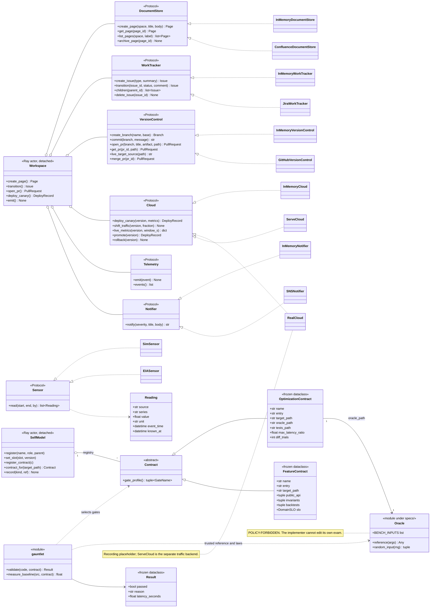
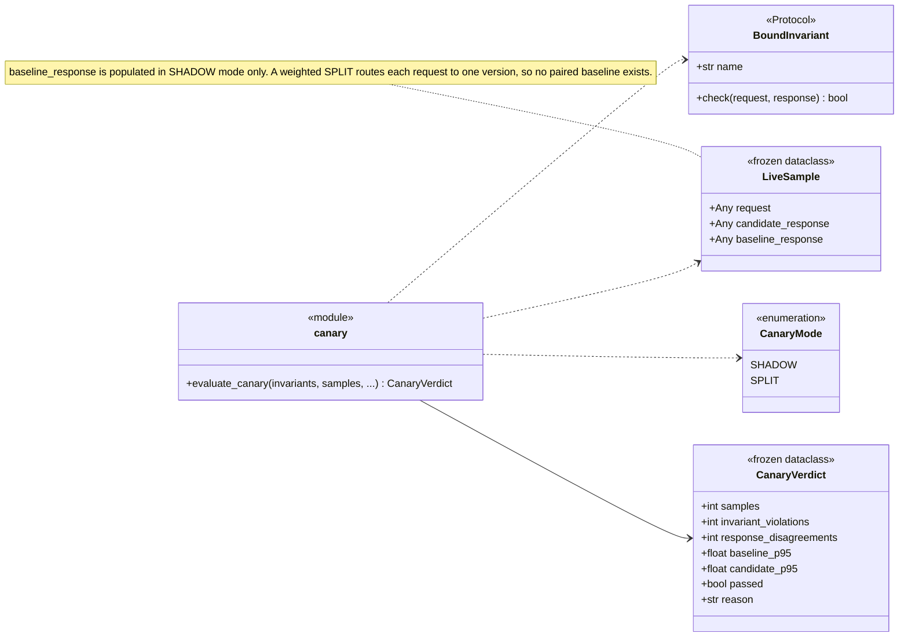
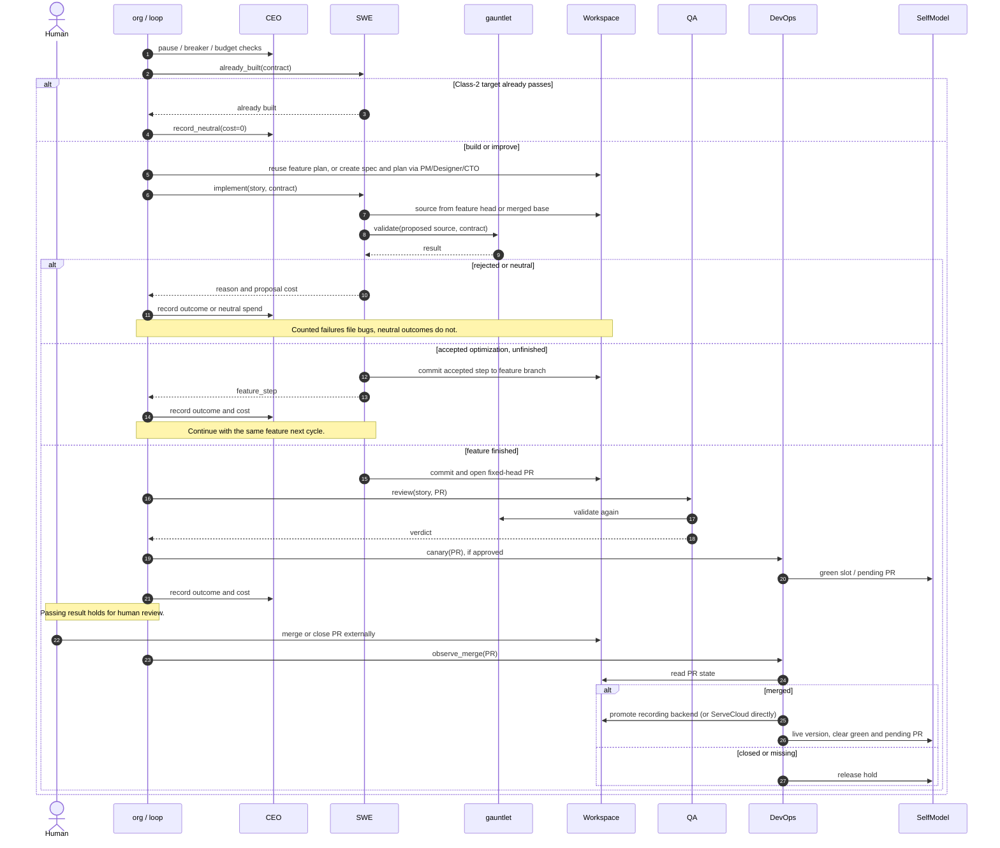
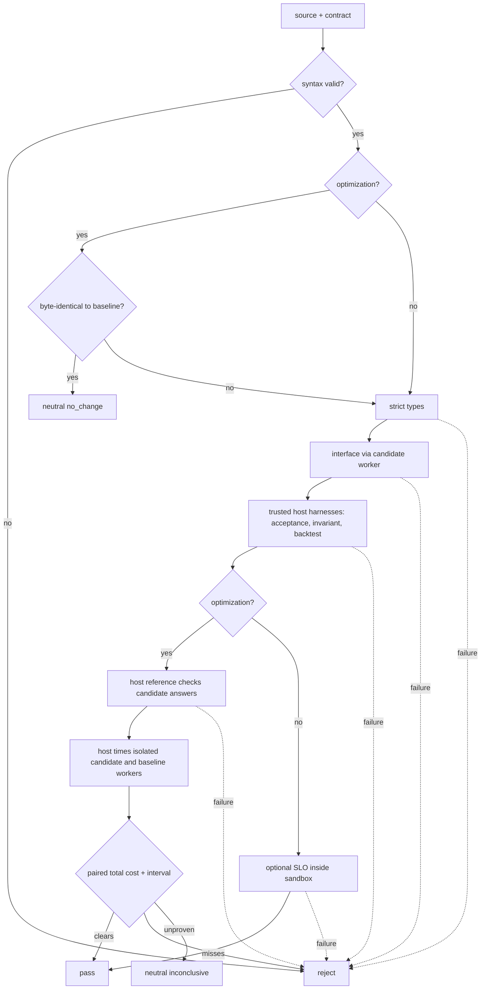
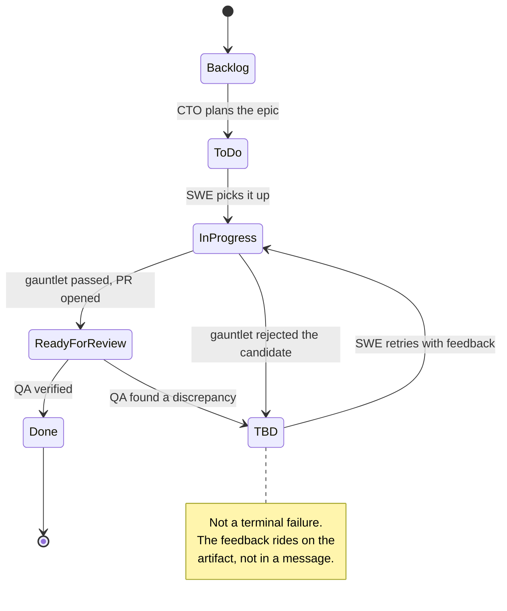
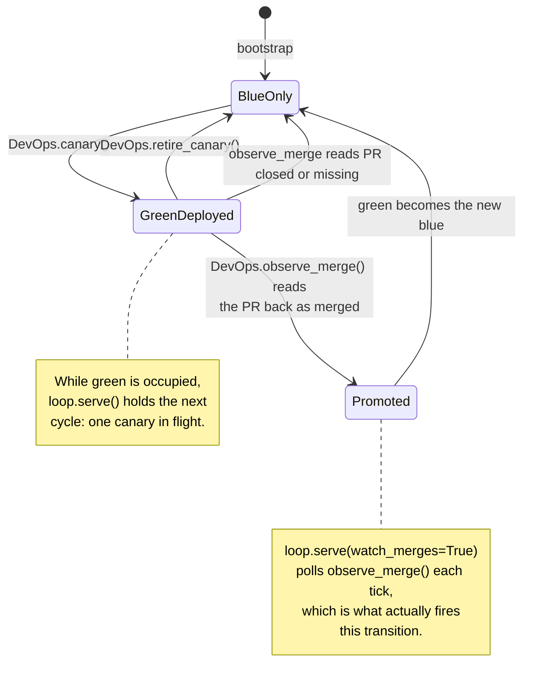

# Diagrams

UML views of omnibase, in Mermaid so they render wherever the markdown is read
and stay in the same commit as the code they describe. Prose lives in
[`ACTORS.md`](../ACTORS.md), [`DESIGN.md`](../DESIGN.md) and
[`CODE_TOUR.md`](CODE_TOUR.md); these are the pictures.

> Keep these honest. A diagram that drifts is worse than none, because it is
> believed. If you change a port, a gate, or a workflow state, change the
> diagram in the same PR.

Contents:
1. [Class — ports, adapters and the contract](#1-class--ports-adapters-and-the-contract)
2. [Sequence — one self-improvement cycle](#2-sequence--one-self-improvement-cycle)
3. [Activity — the validation gauntlet](#3-activity--the-validation-gauntlet)
4. [State — issue workflow and deploy slots](#4-state--issue-workflow-and-deploy-slots)

---

## 1. Class — ports, adapters and the contract

The hexagonal core. Every external capability is a `Protocol` in `sis/ports.py`
with recording/default and real adapters. `Workspace` is the shared artifact
bus for document/tracker/version-control operations. `ServeCloud` is a separate
opt-in traffic backend owned by DevOps. Sensor consumers receive their sensor
explicitly; they do not read it through Workspace. All seven roles and shared
actors are centrally bootstrapped as named, detached actors.

The canary types are the online mirror of the same idea — the contract's
predicates, applied to live traffic instead of generated inputs:

---

## 2. Sequence — one self-improvement cycle

`org.run_cycle()` can finish a feature or add one accepted optimization step.
Plans are reused across steps and rejected attempts feed the next prompt. The
sequence below compresses artifact calls; actors coordinate through Workspace,
with SelfModel retaining contract/deploy/provenance links.

`merge_pr()` always raises `RequiresHumanApproval` in the engine adapters.
Promotion executes only after observing the human merge. A Class-2 feature
finishes at its first passing step; optimization completion follows the feature
step limit or no further gain. See [STAGED_DELIVERY.md](STAGED_DELIVERY.md).

---

## 3. Activity — the validation gauntlet

`Contract.gate_profile()` chooses the path. Undeclared invariants/backtests and
an absent SLO have no work to run. Candidate execution stays in the sandbox;
trusted acceptance/invariant/backtest harnesses and the benchmark judge run on
the host. SLO is the remaining in-process sandboxed gate.

Each gate's completion is checked for exam tampering and the required verdict.
A failed sandboxed gate gets a trusted self-check: if that also fails, the
reason is `harness:`. Gate timeouts kill hangs. Docker's read-only exam mount,
no network, credential-free environment and CPU isolation protect the host;
subprocess mode is a soft guard and cannot enforce that confinement.

Only JSON crosses the worker boundary; tuples become lists and non-wireable
arguments are an exam fault. Timed inputs are never reused after either worker
has seen them; batches run without per-call Python harness work. Docker workers
get distinct single CPUs, swapped halfway. See [CODE_TOUR.md](CODE_TOUR.md).

Serve is outside this boundary and remains refused for non-stub proposers and
Class-2 contracts. See [SERVE_CANARY.md](SERVE_CANARY.md).

---

## 4. State — issue workflow and deploy slots

The issue diagram is the current engine workflow: QA verification marks a story
Done before the human PR merge. Repository contributor Jira stories are moved
Done on merge; that convention is separate from the engine's issue transitions.

**Issue lifecycle** (`sis.ports.IssueStatus`). QA bouncing a story to `TBD`
rather than failing it outright is what makes the SWE↔QA loop an artifact
exchange instead of a conversation.

**Deploy slots** (`SelfModel._slots`). Blue is live, green is the canary. The
loop can put a candidate in green; only a human can make it blue.

`DevOps.observe_merge()` (OMNI-15) is what makes `GreenDeployed → Promoted`
real: it reads the PR back from version control and, only if a human has
*already* merged it, promotes and frees green. `merge_pr` still raises
`RequiresHumanApproval` in every adapter, so the agent can never make that
condition true itself — it can only notice that a human did. Before this
existed, the transition had no trigger at all and the loop idled forever after
one successful cycle.
